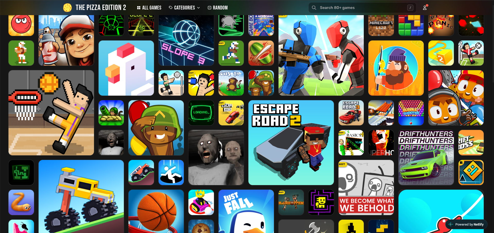

# 🍕 THE PIZZA EDITION 2

A fast, browser-based game hub with a searchable catalog, category pages, and a built-in game player. No downloads, no installs. Just open the site and play.

**▶ Live site:** `https://pizza-edition-2.netlify.app`.



> **Status:** 🟢 Actively developed. This is the main project, and it replaces [UNBLEEKED](https://github.com/LEBRONGOAT2323/unbleeked) and [PHANTOM](https://github.com/LEBRONGOAT2323/PHANTOM).

---

## Features

- 🎮 **Game catalog** – browse the full library from the home page
- 🗂️ **Categories** – a dedicated page for browsing games by type
- ▶️ **Game player** – each game opens in its own play page
- 📝 **Game descriptions** – every game has a short description
- 🤝 **Partners** – a partners list loaded from a data file
- ⚡ **Lightweight** – plain HTML, CSS, and JavaScript with no build step


## Run it

**Online:** open `https://pizza-edition-2.netlify.app`.

**Locally:**

```bash
git clone https://github.com/LEBRONGOAT2323/THE-PIZZA-EDITION-2.git
cd THE-PIZZA-EDITION-2

# any static server works
python3 -m http.server 8000
# or
npx serve
```

Then open `http://localhost:8000`.

> Open it through a local server rather than double-clicking `index.html`, because the site loads its JSON data files with `fetch()`, which browsers block on `file://` pages.

## Tech stack

- **HTML / CSS / JavaScript** (vanilla, no framework)
- **JSON** data files for the catalog
- **Vercel** and **Netlify** for hosting

## How it works

The site is **data-driven**: the content lives in JSON files and `app.js` builds the pages from them, so adding a game means editing data rather than writing new HTML.

| File | Purpose |
|---|---|
| `index.html` | Home page and main game grid |
| `categories.html` | Browse games by category |
| `play.html` | Player page for a selected game |
| `app.js` | Loads the data files and renders the pages |
| `games.json` | The game catalog |
| `descriptions.json` | Short description for each game |
| `partners.json` | Partner sites list |
| `style.css` | Shared styles |
| `g/` | Game files |
| `assets/` | Images and other static assets |
| `vercel.json` | Vercel and Netlify deployment config |


### Adding a game

1. Add the game's files under `g/`.
2. Add an entry for it in `games.json`.
3. Add its description in `descriptions.json`.

### What I learned so far
* A JSON file holding all games is much better than pulling from an external JSON file.
* Game cards arranged in unique ways catch more attention than boring standard grids.
* Having categories keeps everything very organized.
* Having a bunch of different HTML files doesn't mean the project is better.


## Credits and game ownership

All games remain the property of their original creators. Credit and source links for each game are listed in [CREDITS.md](CREDITS.md).

## Roadmap

- [ ] More games
- [ ] Favorites / recently played

---

Built by [LEBRONGOAT2323](https://github.com/LEBRONGOAT2323).
